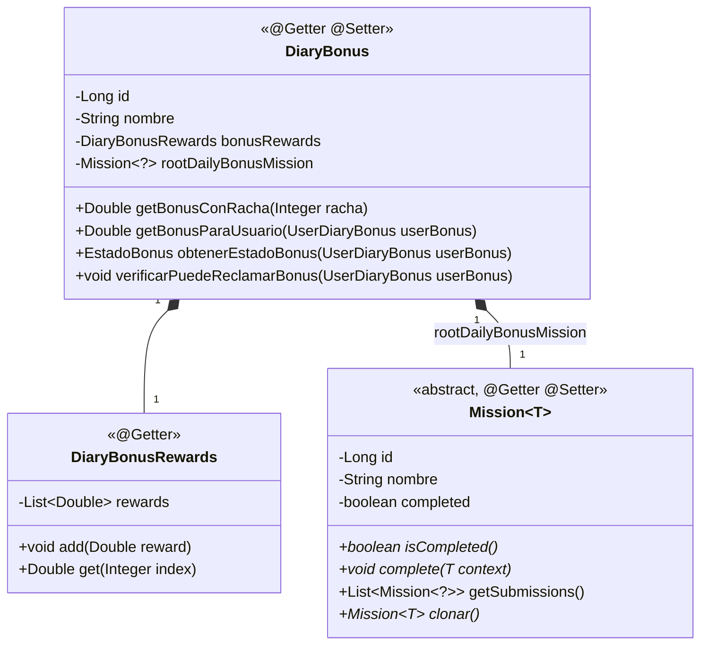
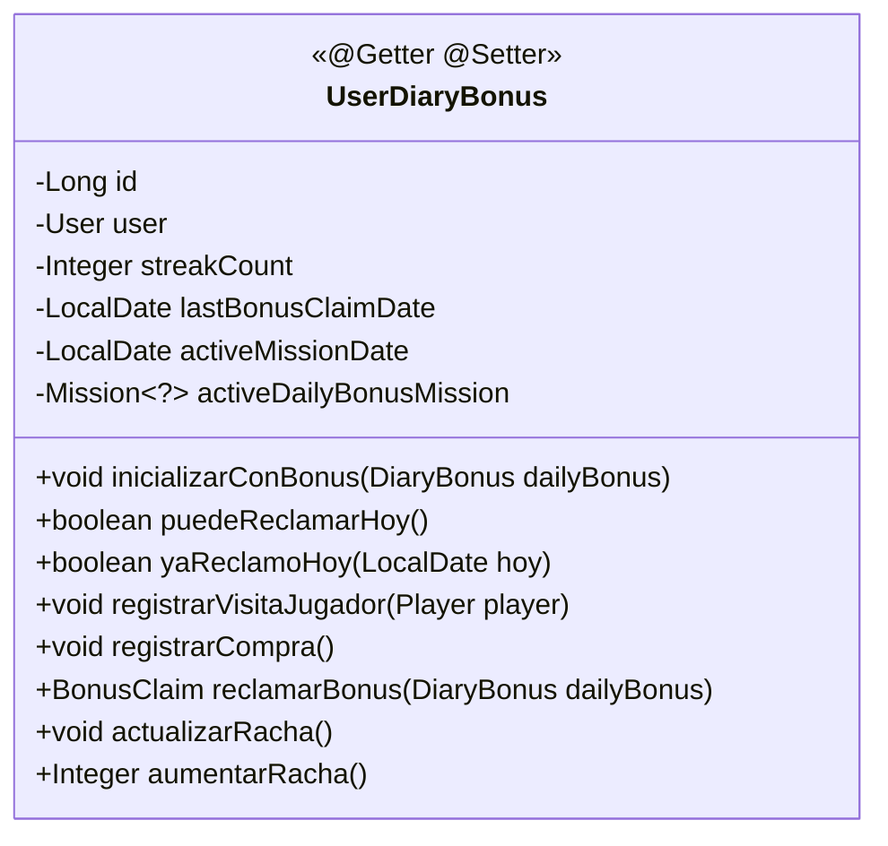
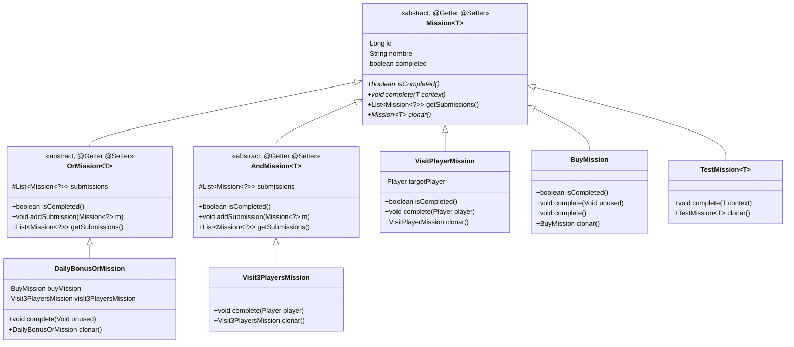
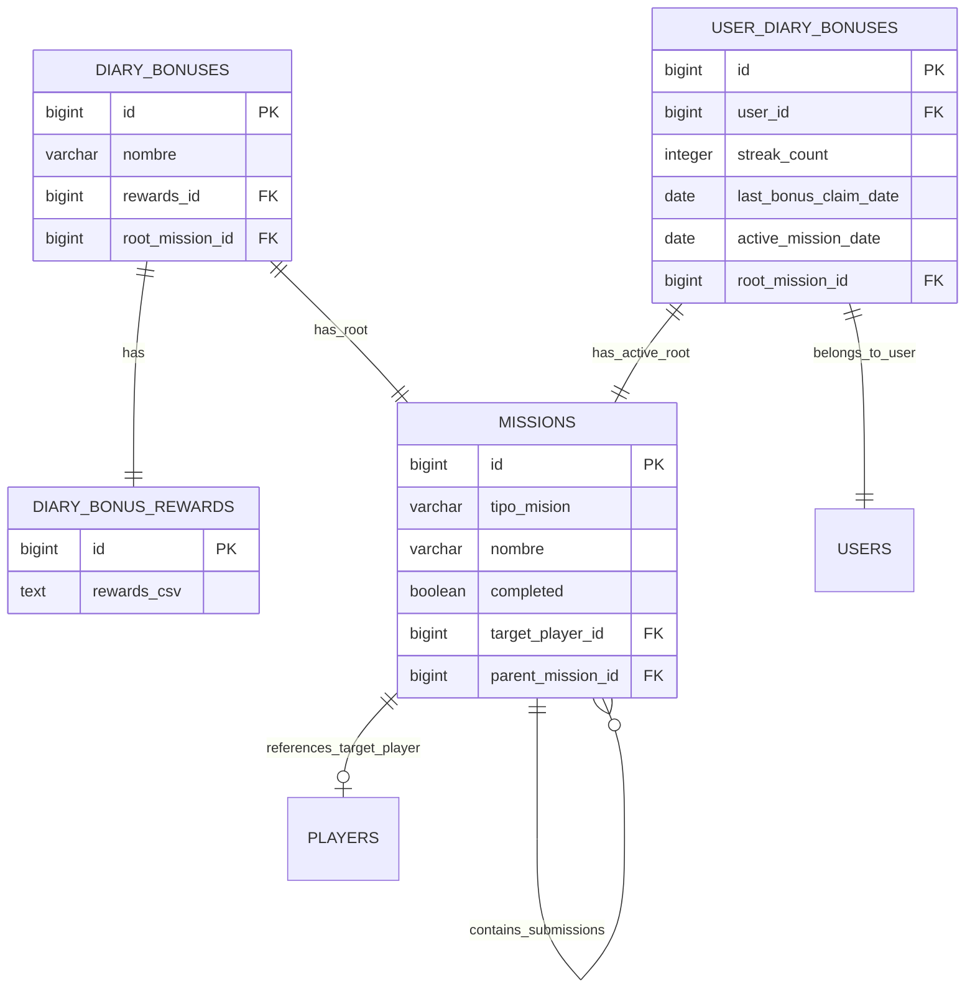

# Data Model: diary-bonus-dailyBonusMissions

## Overview

This document specifies the domain model, persistence entities, state transitions, and validation invariants for the dailyBonusMission-based `DailyBonus` system.

---

## 1. Domain Entities (`com.overcode.model.bonus`)

### 1.1 `DailyBonus`

Represents the daily bonus definition and system schedule. Replaces and adapts `LoginBonus`. Uses Lombok `@Getter` and `@Setter`.



#### Fields:
- `id`: `Long` - Unique identifier.
- `nombre`: `String` - Name of the diary bonus configuration (non-null, non-empty).
- `bonusRewards`: `DailyBonusRewards` - Holds the 7 reward tiers (one per streak day 0..6).
- `rootDailyBonusMission`: `Mission<?>` - Composite root dailyBonusMission defining today's requirements (e.g. `BuyOrVisitMission`).

#### Business Methods & Rules:
- `getBonusConRacha(Integer racha)`: Returns reward for given streak index.
- `verificarPuedeReclamarBonus(UserDiaryBonus userBonus)`:
  - Verifies user has not already claimed today (`BonusYaReclamadoHoyException`).
  - Verifies current date is not prior to last claim date (`FechaReclamoBonusDiarioInvalidaException`).
  - Verifies that `userBonus.puedeReclamarHoy()` is true; throws `RequisitosMisionesNoCumplidosException` if root dailyBonusMission is incomplete.

---

### 1.2 `UserDailyBonus`

Represents the persistent 1-to-1 daily bonus profile for a `User`. Directly encapsulates the `User` domain model. Uses Lombok `@Getter` and `@Setter`.



#### Fields:
- `id`: `Long` - Primary key.
- `user`: `User` - Reference to owner `User` entity (direct domain object reference, non-null).
- `streakCount`: `Integer` - Current consecutive streak count (default: 0, range 0..6).
- `lastBonusClaimDate`: `LocalDate` - Date of last successful claim (nullable).
- `activeMissionDate`: `LocalDate` - Date of the currently assigned daily dailyBonusMission tree.
- `activeDailyBonusMission`: `Mission<?>` - Root composite dailyBonusMission tree assigned to this user for `activeMissionDate`.

#### Business Methods & Lifecycle:
- `inicializarConBonus(DiaryBonus dailyBonus)`:
  - Encapsulates all lazy assignment logic within the domain model.
  - Checks if `activeMissionDate == null || !activeMissionDate.isEqual(getFechaActual()) || activeDailyBonusMission == null`.
  - If initialization is needed:
    - Calls `actualizarRacha()` (resets streak if more than 1 day elapsed).
    - Sets `activeMissionDate = getFechaActual()`.
    - Sets `activeDailyBonusMission = dailyBonus.getMission().clonar()`.
- `registrarVisitaJugador(Player player)`:
  - Dispatches completion with typed `Player` argument to visit dailyBonusMission branches.
- `registrarCompra()`:
  - Dispatches completion with `null` or market trigger to buy dailyBonusMission branch.
- `puedeReclamarHoy()`:
  - Evaluates `activeDailyBonusMission != null && activeDailyBonusMission.isCompleted() && !yaReclamoHoy(getFechaActual())`.
- `reclamarBonus(DiaryBonus dailyBonus)`:
  - Validates eligibility via `dailyBonus.verificarPuedeReclamarBonus(this)`.
  - Determines bonus amount: `dailyBonus.getBonusConRacha(streakCount)`.
  - Advances streak via `aumentarRacha()`.
  - Updates `lastBonusClaimDate = getFechaActual()`.
  - Returns `BonusClaim(bonus, nuevaRacha, user.getCreditBalance())`.

---

### 1.3 Domain Records (`com.overcode.model.bonus`)

Used as strongly-typed, single-parameter domain arguments across service boundary calls:

```java
package com.overcode.model.bonus;

import com.overcode.model.player.Player;
import com.overcode.model.user.User;

public record PeticionVisitaJugador(User user, Player player) {}
```

---

## 2. Mission Composite Hierarchy (`com.overcode.model.bonus.dailyBonusMission`)

The dailyBonusMission system strictly implements the composite pattern via generic `Mission<T>` and abstract composite classes `OrMission<T>` and `AndMission<T>`. All classes use Lombok `@Getter` and `@Setter`. It does **not** rely on artificial boolean optional flags; alternative branches are expressed through `OrDailyBonusMission`. Completion arguments are strictly parameterized per subclass.



### 2.1 Component Specifications

1. **`Mission<T>` (Abstract Base Class)**:
   - Holds `id`, `nombre`, and `completed` (boolean). Annotated with `@Getter` and `@Setter`.
   - **No boolean optional field**: Optional branches are modeled naturally by `OrDailyBonusMission`.
   - Methods:
     - `public abstract boolean isCompleted();`
     - `public abstract void complete(T context);` — **Parameter is strictly typed with `T`**, not raw `Object`.
     - `public abstract Mission<T> clonar();`
     - `public List<Mission<?>> getSubmissions()` — default empty list for leaf nodes.
2. **`OrMission<T>` (Abstract Composite Class)**:
   - Represents the OR behavior of the composite pattern. Annotated with `@Getter` and `@Setter`.
   - Holds `List<Mission<?>> submissions`.
   - `isCompleted()`: Returns `true` if **any** child dailyBonusMission has `isCompleted() == true` (`submissions.stream().anyMatch(Mission::isCompleted)`).
3. **`AndMission<T>` (Abstract Composite Class)**:
   - Represents the AND behavior of the composite pattern. Annotated with `@Getter` and `@Setter`.
   - Holds `List<Mission<?>> submissions`.
   - `isCompleted()`: Returns `true` if **all** child dailyBonusMissions have `isCompleted() == true` (`submissions.stream().allMatch(Mission::isCompleted)`).
4. **`DailyBonusOrMission extends OrMission<Void>`**:
   - Concrete `OrDailyBonusMission` root holding `BuyDailyBonusMission` and `Visit3PlayersDailyBonusMission`.
   - `isCompleted()`: returns true if either the buy dailyBonusMission is completed OR all 3 player visits are completed.
   - `complete(Void unused)`: no-op default for top-level void trigger.
5. **`Visit3PlayersMission extends AndMission<Player>`**:
   - Concrete `AndDailyBonusMission` composed of 3 distinct `VisitPlayerDailyBonusMission` instances.
   - `@Override public void complete(Player player)`: forwards the player to all child `VisitPlayerDailyBonusMission` instances.
   - `isCompleted()`: returns true only when all 3 player visit dailyBonusMissions are completed.
6. **`VisitPlayerMission extends Mission<Player>`**:
   - Parameterized by `Player`.
   - Holds `Player targetPlayer`.
   - `@Override public void complete(Player player)`: checks if `this.targetPlayer.getId().equals(player.getId())`; if matched, sets `this.completed = true`.
7. **`BuyMission extends Mission<Void>`**:
   - Parameterized by `Void`.
   - `@Override public void complete(Void unused)`: sets `this.completed = true`.
   - Convenience overload: `public void complete() { complete(null); }`.
8. **`TestMission<T> extends Mission<T>`**:
   - Reusable parameterized test dailyBonusMission class used in unit tests to verify composite mechanics (`AndDailyBonusMission` and `OrDailyBonusMission`) in isolation before complex dailyBonusMissions.

---

## 3. Service Layer Method Signatures (Strict 1-Parameter Contract)

Services MUST receive exactly one parameter per method, and the parameter MUST be a domain model entity or domain record (never a `RequestDTO`):

### 3.1 `DailyBonusService`
- `BonusClaim reclamarBonus(User user);`
- `EstadoBonus obtenerEstadoBonus(User user);`
- `EstadoBonus registrarVisitaJugador(PeticionVisitaJugador peticion);`

### 3.2 `UserDailyBonusService`
- `UserDiaryBonus recuperarOPermitirCrear(User user);`
- `UserDiaryBonus guardar(UserDiaryBonus userDailyBonus);`
- `void registrarCompra(User user);`

### 3.3 `DiaryBonusService`
- `DiaryBonus recuperarSeleccionado();`
- `DiaryBonus guardar(DiaryBonus dailyBonus);`

---

## 4. Persistence Schema & DTOs (`com.overcode.persistence`)

All JPA DTOs use Lombok `@Getter`, `@Setter`, and `@NoArgsConstructor`.

### 4.1 Entity Relationship Diagram



### 4.2 Persistence Components Table

| Layer | Component Name | Description |
|---|---|---|
| Model | `DailyBonus`, `DailyBonusRewards` | Domain models for bonus schedule & rewards. |
| Model | `UserDailyBonus` | User's daily bonus profile referencing `User`. |
| Model | `Mission<T>`, `OrMission<T>`, `AndMission<T>`, `BuyOrVisitMission`, `Visit3PlayersDailyBonusMission`, `VisitPlayerDailyBonusMission`, `BuyDailyBonusMission` | Generic composite dailyBonusMission hierarchy. |
| Model Record | `PeticionVisitaJugador` | Domain record for single-parameter service calls. |
| JPA DTO | `DailyBonusJPADTO`, `DailyBonusRewardsJPADTO` | JPA mapping for `diary_bonuses`. |
| JPA DTO | `UserDailyBonusJPADTO` | JPA mapping for `user_diary_bonuses` (links to `UserJPADTO`). |
| JPA DTO | `DailyBonusMissionJPADTO` | Single-table JPA mapping for recursive dailyBonusMission trees (NO optionality column). |
| DAO JPA | `DailyBonusDAOJPA` | Spring Data JPA repository for `DailyBonusJPADTO`. |
| DAO JPA | `UserDiaryBonusDAOJPA` | Spring Data JPA repository for `UserDailyBonusJPADTO`. |
| DAO JPA | `DailyBonusMissionDAOJPA` | Spring Data JPA repository for `DailyBonusMissionJPADTO`. |
| Repo Interface | `DailyBonusRepository` | Boundary for diary bonus persistence. |
| Repo Interface | `UserDailyBonusRepository` | Boundary for user daily bonus persistence. |
| Repo Interface | `DailyBonusMissionRepository` | Boundary for dailyBonusMission persistence. |
| Repo Impl | `DailyBonusRepositoryImpl` | Implementation converting DTO <-> Model. |
| Repo Impl | `UserDailyBonusRepositoryImpl` | Implementation converting DTO <-> Model. |
| Repo Impl | `DailyBonusMissionRepositoryImpl` | Implementation converting DTO <-> Model. |
