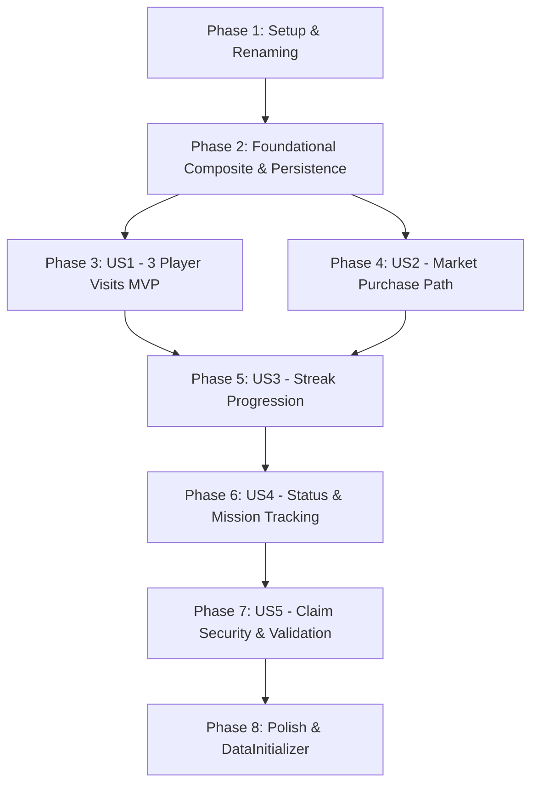

# Tasks: diary-bonus-dailyBonusMissions

**Input**: Design documents from `specs/010-diary-bonus-dailyBonusMissions/` (`plan.md`, `spec.md`, `research.md`, `data-model.md`, `contracts/daily-bonus-api.yaml`, `quickstart.md`).  
**Prerequisites**: `plan.md` (required), `spec.md` (required), `data-model.md`, `contracts/daily-bonus-api.yaml`, `research.md`.  
**Tests**: Explicitly requested by user and constitution (Unit tests in Spanish for Model, Integration tests with Testcontainers, E2E tests with SpringBootTest).  
**Organization**: Tasks are grouped by user story to enable independent implementation and testing of each story.

## Format: `- [ ] [TaskID] [P?] [Story?] Description with file path`

- **[P]**: Can run in parallel (different files, no dependencies)
- **[Story]**: Which user story this task belongs to (e.g., `[US1]`, `[US2]`, `[US3]`, `[US4]`, `[US5]`)
- Every task includes exact file paths

---

## Phase 1: Setup (Renaming & Adapting `LoginBonus` to `DailyBonus`)

**Purpose**: Adapt and rename all legacy `LoginBonus` domain, persistence, service, and test components to `DailyBonus` without regressing existing market or user dependencies.

- [X] T001 [P] Rename and adapt domain exception `LoginBonusInvalidoException` to `DailyBonusInvalidoException` in `src/main/java/com/overcode/model/exception/bonus/DiaryBonusInvalidoException.java`
- [X] T002 [P] Rename and adapt domain rewards class `LoginBonusRewards` to `DailyBonusRewards` using Lombok `@Getter` in `src/main/java/com/overcode/model/bonus/DiaryBonusRewards.java`
- [X] T003 Rename and adapt domain entity `LoginBonus` to `DailyBonus` using Lombok `@Getter` and `@Setter` in `src/main/java/com/overcode/model/bonus/DiaryBonus.java`
- [X] T004 [P] Rename and adapt persistence DTO `LoginBonusRewardsJPADTO` to `DailyBonusRewardsJPADTO` in `src/main/java/com/overcode/persistence/dto/jpa/bonus/DiaryBonusRewardsJPADTO.java`
- [X] T005 Rename and adapt persistence DTO `LoginBonusJPADTO` to `DailyBonusJPADTO` in `src/main/java/com/overcode/persistence/dto/jpa/bonus/DiaryBonusJPADTO.java`
- [X] T006 [P] Rename and adapt DAO interface `LoginBonusDAOJPA` to `DailyBonusDAOJPA` in `src/main/java/com/overcode/persistence/repository/dao/jpa/DiaryBonusDAOJPA.java`
- [X] T007 [P] Rename and adapt repository interface `LoginBonusRepository` to `DailyBonusRepository` in `src/main/java/com/overcode/persistence/repository/interfaces/DiaryBonusRepository.java`
- [X] T008 [P] Rename and adapt persistence exception `LoginBonusPersistenciaException` to `DiaryBonusPersistenciaException` in `src/main/java/com/overcode/persistence/exception/DiaryBonusPersistenciaException.java`
- [X] T009 Implement `DailyBonusRepositoryImpl` implementing `DailyBonusRepository` in `src/main/java/com/overcode/persistence/repository/impl/DiaryBonusRepositoryImpl.java`
- [X] T010 [P] Rename and adapt service interface `LoginBonusService` to `DiaryBonusService` in `src/main/java/com/overcode/service/interfaces/DiaryBonusService.java`
- [X] T011 Implement `DiaryBonusServiceImpl` implementing `DiaryBonusService` in `src/main/java/com/overcode/service/impl/DiaryBonusServiceImpl.java`
- [X] T012 Update `ConfiguracionMercado` and `ConfiguracionMercadoJPADTO` references from `LoginBonus` to `DailyBonus` in `src/main/java/com/overcode/model/cotizacion/ConfiguracionMercado.java` and `src/main/java/com/overcode/persistence/dto/jpa/cotizacion/ConfiguracionMercadoJPADTO.java`
- [X] T013 [P] Rename and adapt test utility `TestLoginBonusUtil` to `TestDailyBonusUtil` with static factory methods in `src/test/java/com/overcode/testUtils/TestDiaryBonusUtil.java`
- [X] T014 Adapt existing model unit tests `LoginBonusTest` and `LoginBonusRewardsTest` to `DailyBonusTest` and `DailyBonusRewardsTest` in `src/test/java/com/overcode/model/bonus/DiaryBonusTest.java` and `src/test/java/com/overcode/model/bonus/DiaryBonusRewardsTest.java`
- [X] T015 Adapt repository integration test `LoginBonusRepositoryTest` to `DailyBonusRepositoryTest` in `src/test/java/com/overcode/persistence/repository/DiaryBonusRepositoryTest.java`

**Checkpoint**: `DailyBonus` fully replaces `LoginBonus` across the application. All existing unit and repository tests pass.

---

## Phase 2: Foundational (Generic Composite `Mission<T>` & `UserDailyBonus` Persistence)

**Purpose**: Core dailyBonusMission composite tree hierarchy and persistent `UserDailyBonus` profile infrastructure that MUST be complete before user stories can be implemented.

- [X] T016 [P] Create domain exception `MisionInvalidaException` in `src/main/java/com/overcode/model/exception/bonus/MisionInvalidaException.java`
- [X] T017 [P] Create domain exception `RequisitosMisionesNoCumplidosException` in `src/main/java/com/overcode/model/exception/bonus/RequisitosMisionesNoCumplidosException.java`
- [X] T018 Create abstract generic base class `Mission<T>` with Lombok `@Getter` and `@Setter`, abstract methods `isCompleted()`, `complete(T context)`, `clonar()`, and `getSubmissions()` (no boolean optional flag) in `src/main/java/com/overcode/model/bonus/dailyBonusMission/Mission.java`
- [X] T019 Create abstract composite class `OrMission<T> extends Mission<T>` with Lombok `@Getter` and `@Setter`, encapsulating OR behavior in `src/main/java/com/overcode/model/bonus/dailyBonusMission/OrMission.java`
- [X] T020 Create abstract composite class `AndMission<T> extends Mission<T>` with Lombok `@Getter` and `@Setter`, encapsulating AND behavior in `src/main/java/com/overcode/model/bonus/dailyBonusMission/AndMission.java`
- [X] T021 [P] Create `TestMission<T> extends Mission<T>` for unit test assertions in `src/main/java/com/overcode/model/bonus/dailyBonusMission/TestMission.java`
- [X] T022 [P] Create static factory utility `TestMissionUtil` with methods for instantiating model test dailyBonusMissions in `src/test/java/com/overcode/testUtils/TestMissionUtil.java`
- [X] T023 Implement unit tests in Spanish for `AndDailyBonusMission`, `OrDailyBonusMission`, and `TestDailyBonusMission` composite mechanics in `src/test/java/com/overcode/model/bonus/dailyBonusMission/MissionTest.java`
- [X] T024 Create persistence DTO `DailyBonusMissionJPADTO` for recursive tree mapping without optionality column in `src/main/java/com/overcode/persistence/dto/jpa/bonus/MissionJPADTO.java`
- [X] T025 [P] Create DAO interface `MissionDAOJPA` extending `JpaRepository` in `src/main/java/com/overcode/persistence/repository/dao/jpa/MissionDAOJPA.java`
- [X] T026 [P] Create repository interface `MissionRepository` in `src/main/java/com/overcode/persistence/repository/interfaces/MissionRepository.java`
- [X] T027 Implement `MissionRepositoryImpl` in `src/main/java/com/overcode/persistence/repository/impl/MissionRepositoryImpl.java`
- [X] T028 [P] Create service interface `MissionService` in `src/main/java/com/overcode/service/interfaces/MissionService.java`
- [X] T029 Implement `MissionServiceImpl` with single-parameter methods in `src/main/java/com/overcode/service/impl/MissionServiceImpl.java`
- [X] T030 Create domain record `PeticionVisitaJugador(User user, Player player)` in `src/main/java/com/overcode/model/bonus/PeticionVisitaJugador.java`
- [X] T031 Create domain entity `UserDailyBonus` holding `User user`, streak fields, active dailyBonusMissions, Lombok `@Getter`/`@Setter`, and `inicializarConBonus(DiaryBonus dailyBonus)` encapsulating lazy initialization in `src/main/java/com/overcode/model/bonus/UserDiaryBonus.java`
- [X] T032 Create persistence DTO `UserDailyBonusJPADTO` linking `@OneToOne` or `@ManyToOne` to `UserJPADTO` in `src/main/java/com/overcode/persistence/dto/jpa/bonus/UserDiaryBonusJPADTO.java`
- [X] T033 [P] Create DAO interface `UserDiaryBonusDAOJPA` in `src/main/java/com/overcode/persistence/repository/dao/jpa/UserDiaryBonusDAOJPA.java`
- [X] T034 [P] Create repository interface `UserDailyBonusRepository` in `src/main/java/com/overcode/persistence/repository/interfaces/UserDiaryBonusRepository.java`
- [X] T035 Implement `UserDailyBonusRepositoryImpl` in `src/main/java/com/overcode/persistence/repository/impl/UserDiaryBonusRepositoryImpl.java`
- [X] T036 [P] Create service interface `UserDailyBonusService` with single-parameter methods in `src/main/java/com/overcode/service/interfaces/UserDiaryBonusService.java`
- [X] T037 Implement `UserDailyBonusServiceImpl` delegating lazy assignment to `userDailyBonus.inicializarConBonus(dailyBonus)` in `src/main/java/com/overcode/service/impl/UserDiaryBonusServiceImpl.java`
- [X] T038 Create repository integration test `UserDailyBonusRepositoryTest` using Testcontainers PostgreSQL in `src/test/java/com/overcode/persistence/repository/UserDiaryBonusRepositoryTest.java`

**Checkpoint**: Core composite dailyBonusMission infrastructure and `UserDailyBonus` persistence foundation verified. User stories can now proceed.

---

## Phase 3: User Story 1 - Completing Daily Missions via Player Visits to Unlock and Claim Bonus (Priority: P1) 🎯 MVP

**Goal**: Users complete 3 distinct daily player visit dailyBonusMissions, qualify for today's bonus without market purchases, and claim their reward.

**Independent Test**: Register visits for 3 designated players, assert claim eligibility turns true, submit claim, verify credit award and streak progression.

### Tests for User Story 1 ⚠️

- [X] T039 [P] [US1] Unit test in Spanish for `VisitPlayerDailyBonusMission` verifying player matching and completion in `src/test/java/com/overcode/model/bonus/dailyBonusMission/VisitPlayerMissionTest.java`
- [X] T040 [P] [US1] Integration test in Spanish in `src/test/java/com/overcode/service/bonus/BonusServiceImplTest.java` verifying 3 player visits qualify user to claim bonus via `BonusService.reclamarBonus(User user)`
- [X] T041 [US1] E2E test in Spanish verifying 3 player visits via HTTP POST endpoints unlock bonus claim in `src/test/java/com/overcode/e2e/DailyBonusE2eTest.java`

### Implementation for User Story 1

- [X] T042 [P] [US1] Create concrete model `VisitPlayerMission extends Mission<Player>` with target `Player` check in `src/main/java/com/overcode/model/bonus/dailyBonusMission/VisitPlayerMission.java`
- [X] T043 [US1] Create concrete composite model `Visit3PlayersMission extends AndMission<Player>` composed of 3 `VisitPlayerDailyBonusMission` instances in `src/main/java/com/overcode/model/bonus/dailyBonusMission/Visit3PlayersMission.java`
- [X] T044 [P] [US1] Add static factory methods `crearVisitPlayerMission` and `crearVisit3PlayersMission` to `src/test/java/com/overcode/testUtils/TestMissionUtil.java`
- [X] T045 [US1] Implement `registrarVisitaJugador(PeticionVisitaJugador peticion)` in `DailyBonusService` and `DailyBonusServiceImpl` in `src/main/java/com/overcode/service/interfaces/BonusService.java` and `src/main/java/com/overcode/service/impl/BonusServiceImpl.java`
- [X] T046 [US1] Add `POST /api/daily-bonus/visit/{playerId}` endpoint in `DailyBonusController` delegating `PeticionVisitaJugador` to `DailyBonusService` in `src/main/java/com/overcode/controller/DailyBonusController.java`

**Checkpoint**: User Story 1 functional end-to-end. Authenticated users can visit 3 designated player pages and claim their daily bonus.

---

## Phase 4: User Story 2 - Completing Daily Missions via Market Purchase to Unlock and Claim Bonus (Priority: P1)

**Goal**: Purchasing any token on the market immediately qualifies the user for today's daily bonus without requiring player visits.

**Independent Test**: Simulate purchasing a market token with 0 player visits, assert claim eligibility turns true, and verify bonus claim awards credits.

### Tests for User Story 2 ⚠️

- [X] T047 [P] [US2] Unit test in Spanish for `BuyDailyBonusMission` and `BuyOrVisitMission` verifying buy completion satisfies OR composite in `src/test/java/com/overcode/model/bonus/dailyBonusMission/BuyMissionTest.java`
- [X] T048 [P] [US2] Integration test in Spanish in `src/test/java/com/overcode/service/bonus/BonusServiceImplTest.java` verifying market purchase triggers dailyBonusMission completion and unlocks claim
- [X] T049 [US2] E2E test in Spanish in `src/test/java/com/overcode/e2e/DailyBonusE2eTest.java` verifying market token purchase unlocks immediate daily bonus claim

### Implementation for User Story 2

- [X] T050 [P] [US2] Create concrete model `BuyMission extends Mission<Void>` with `complete(Void unused)` and convenience `complete()` in `src/main/java/com/overcode/model/bonus/dailyBonusMission/BuyMission.java`
- [X] T051 [US2] Create root composite model `DailyBonusOrMission extends OrMission<Void>` uniting `BuyDailyBonusMission` and `Visit3PlayersDailyBonusMission` in `src/main/java/com/overcode/model/bonus/dailyBonusMission/DailyBonusOrMission.java`
- [X] T052 [US2] Add method `registrarCompra(User user)` to `UserDailyBonusService` and `UserDailyBonusServiceImpl` in `src/main/java/com/overcode/service/interfaces/UserDiaryBonusService.java` and `src/main/java/com/overcode/service/impl/UserDiaryBonusServiceImpl.java`
- [X] T053 [US2] Update `TokenMarketServiceImpl.buy(...)` to notify `userDailyBonusService.registrarCompra(buyer)` upon successful purchase in `src/main/java/com/overcode/service/impl/TokenMarketServiceImpl.java`

**Checkpoint**: User Story 2 functional. Market purchase completes `BuyDailyBonusMission` and satisfies `BuyOrVisitMission` to enable claiming.

---

## Phase 5: User Story 3 - Daily Streak Progression and Reset on Inactivity (Priority: P1)

**Goal**: Ensure streak increments on consecutive claims, resets to 0 when days are missed, and rolls over cleanly after day 7 (index 6).

**Independent Test**: Simulate consecutive daily claims advancing streak 0 -> 1 -> 2 -> ... -> 6 -> 0, and simulate a missed calendar day resetting streak to 0 with base reward.

### Tests for User Story 3 ⚠️

- [X] T054 [P] [US3] Unit tests in Spanish for `UserDailyBonus` streak calculation, consecutive days, missed days reset, and weekly rollover in `src/test/java/com/overcode/model/bonus/UserDiaryBonusTest.java`
- [X] T055 [US3] Integration test in Spanish with `DateMockConfiguration` verifying multi-day streak advancement and reset in `src/test/java/com/overcode/service/bonus/BonusServiceImplTest.java`
- [X] T056 [US3] E2E test in Spanish in `src/test/java/com/overcode/e2e/DailyBonusE2eTest.java` verifying streak progression and reward tier payouts across consecutive and missed days

### Implementation for User Story 3

- [X] T057 [US3] Implement streak progression logic (`actualizarRacha()`, `aumentarRacha()`, `calcularSiguienteRacha()`) inside `UserDailyBonus` in `src/main/java/com/overcode/model/bonus/UserDiaryBonus.java`
- [X] T058 [US3] Connect `reclamarBonus(DiaryBonus dailyBonus)` in `UserDailyBonus` to credit rewards according to current streak tier in `src/main/java/com/overcode/model/bonus/UserDiaryBonus.java`

**Checkpoint**: User Story 3 functional. Streak arithmetic, reset, and rollover fully enforced within `UserDailyBonus`.

---

## Phase 6: User Story 4 - Tracking Daily Mission Progress and Reward Schedule (Priority: P2)

**Goal**: Users can inspect their current daily dailyBonusMissions, individual completion progress, claim eligibility, current streak, and weekly reward schedule.

**Independent Test**: Query GET `/api/daily-bonus` across unstarted, partially completed, and claimed states; verify returned DTO matches user progress.

### Tests for User Story 4 ⚠️

- [X] T059 [P] [US4] Integration test in Spanish in `src/test/java/com/overcode/service/bonus/BonusServiceImplTest.java` verifying `obtenerEstadoBonus(User user)` returns accurate dailyBonusMission completion tree
- [X] T060 [US4] E2E test in Spanish in `src/test/java/com/overcode/e2e/DailyBonusE2eTest.java` verifying GET `/api/daily-bonus` returns structured dailyBonusMission statuses and upcoming rewards

### Implementation for User Story 4

- [X] T061 [P] [US4] Create response DTO `MissionStatusResponseDTO` (without boolean optional field) in `src/main/java/com/overcode/controller/dto/bonus/MissionStatusResponseDTO.java`
- [X] T062 [US4] Update `EstadoBonus` to hold active dailyBonusMission list and claim readiness in `src/main/java/com/overcode/model/bonus/EstadoBonus.java`
- [X] T063 [US4] Update `DailyBonusStatusResponseDTO` to include `List<MissionStatusResponseDTO>` and `puedeReclamar` flag in `src/main/java/com/overcode/controller/dto/bonus/DailyBonusStatusResponseDTO.java`
- [X] T064 [US4] Implement `obtenerEstadoBonus(User user)` in `DailyBonusServiceImpl` calling `userDailyBonus.inicializarConBonus(dailyBonus)` and returning `EstadoBonus` in `src/main/java/com/overcode/service/impl/BonusServiceImpl.java`

**Checkpoint**: User Story 4 functional. Mission progress and status transparently surfaced to the API caller.

---

## Phase 7: User Story 5 - Rejection of Premature Claims and Duplicate Claim Prevention (Priority: P2)

**Goal**: Prevent claims before fulfilling dailyBonusMission conditions and block duplicate claims within the same calendar day.

**Independent Test**: Attempt premature claim expecting 400 Bad Request; attempt duplicate claim on same day expecting 400 Bad Request.

### Tests for User Story 5 ⚠️

- [X] T065 [P] [US5] Unit tests in Spanish asserting `RequisitosMisionesNoCumplidosException` and `BonusYaReclamadoHoyException` in `src/test/java/com/overcode/model/bonus/UserDiaryBonusTest.java`
- [X] T066 [US5] Integration test in Spanish in `src/test/java/com/overcode/service/bonus/BonusServiceImplTest.java` verifying premature and duplicate claims are rejected
- [X] T067 [US5] E2E test in Spanish in `src/test/java/com/overcode/e2e/DailyBonusE2eTest.java` asserting 400 Bad Request on premature and duplicate claims

### Implementation for User Story 5

- [X] T068 [US5] Implement eligibility verification in `DiaryBonus.verificarPuedeReclamarBonus(UserDiaryBonus userBonus)` throwing domain exceptions in `src/main/java/com/overcode/model/bonus/DiaryBonus.java`
- [X] T069 [US5] Map domain exceptions (`RequisitosMisionesNoCumplidosException`, `BonusYaReclamadoHoyException`) to HTTP 400 in `GlobalExceptionHandler` in `src/main/java/com/overcode/controller/GlobalExceptionHandler.java`

**Checkpoint**: User Story 5 functional. Economic security invariants guaranteed.

---

## Phase 8: Polish & Cross-Cutting Concerns

**Purpose**: System initialization, integration fixtures, and end-to-end validation.

- [X] T070 Update `DataInitializer` to seed system `DailyBonus` with 3 distinct random players (verifying at least 3 active players exist in repository, throwing configuration error otherwise) and 1 market buy dailyBonusMission in `src/main/java/com/overcode/config/DataInitializer.java`
- [X] T071 [P] Update test fixtures in `src/test/java/com/overcode/testUtils/TestService.java` to support `UserDailyBonus` and `DailyBonusMission` teardown
- [X] T072 Execute complete validation test suite per `quickstart.md` (`./mvnw test`)

---

## Dependencies & Execution Order

### Phase Dependencies

### User Story Dependencies

- **User Story 1 (P1 - MVP)**: Starts immediately after Phase 2 (Foundational). Delivers the primary free-to-play engagement path.
- **User Story 2 (P1)**: Starts after Phase 2. Integrates with `TokenMarketServiceImpl`.
- **User Story 3 (P1)**: Extends claim mechanics from US1/US2 with streak arithmetic.
- **User Story 4 (P2)**: Surfaces dailyBonusMission tree progress assembled across US1/US2/US3.
- **User Story 5 (P2)**: Enforces validation gates on claim paths established in US1/US2.

---

## Parallel Opportunities

- **Phase 1 Parallel Execution**:
  - `T001`, `T002`, `T004`, `T006`, `T007`, `T008`, `T010`, `T013` can all execute concurrently across separate files.
- **Phase 2 Parallel Execution**:
  - `T016`, `T017`, `T021`, `T022` can execute concurrently before model assembly.
  - `T025`, `T026`, `T028`, `T030`, `T033`, `T034`, `T036` can run concurrently for persistence interfaces.
- **Cross-Story Parallel Execution**:
  - After Phase 2, `US1` (Player Visits) and `US2` (Market Buy) can be implemented in parallel by separate developers.

---

## Implementation Strategy

### MVP First (User Story 1 Only)

1. Complete Phase 1: Setup & Renaming (`LoginBonus` -> `DailyBonus`).
2. Complete Phase 2: Foundational (Generic `Mission<T>`, `AndDailyBonusMission`, `OrDailyBonusMission`, `UserDailyBonus` persistence).
3. Complete Phase 3: User Story 1 (3 Player profile visits to unlock daily bonus).
4. **VALIDATE MVP**: Execute `mvn test -Dtest=VisitPlayerMissionTest,UserDiaryBonusRepositoryTest,BonusServiceImplTest,DailyBonusE2eTest`.

### Incremental Delivery

1. Foundation + US1 → Core MVP deployed (Visit 3 players to claim).
2. Add US2 → Marketplace shortcut enabled (Buy token to claim).
3. Add US3 → Full 7-day streak progression & reset activated.
4. Add US4 & US5 → Rich status reporting and economic security guardrails locked.
5. Polish → DataInitializer daily seeding configured.
